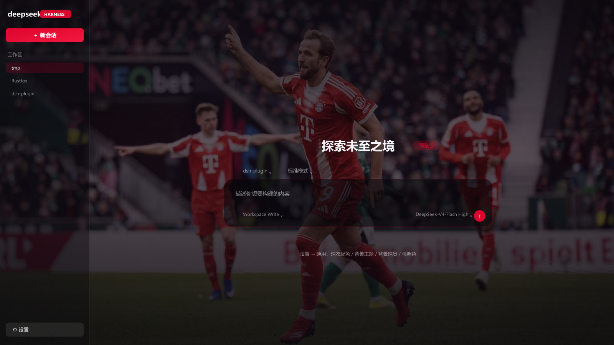
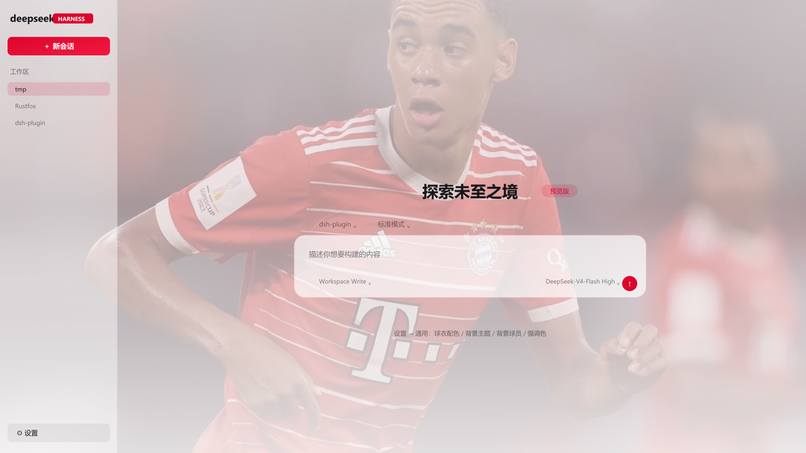
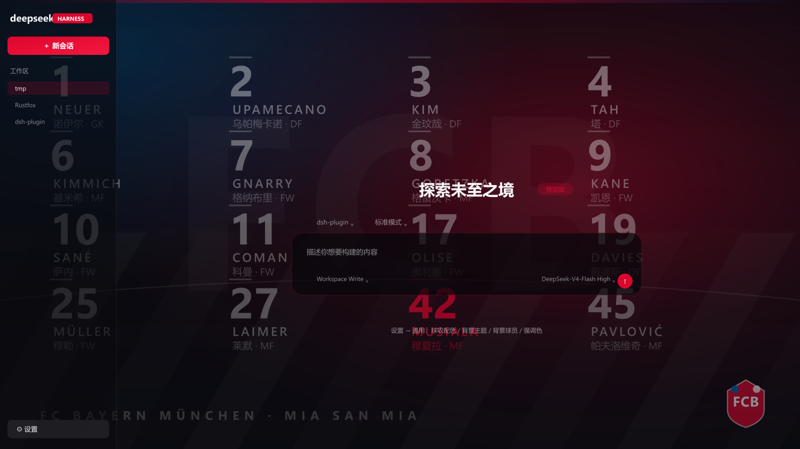
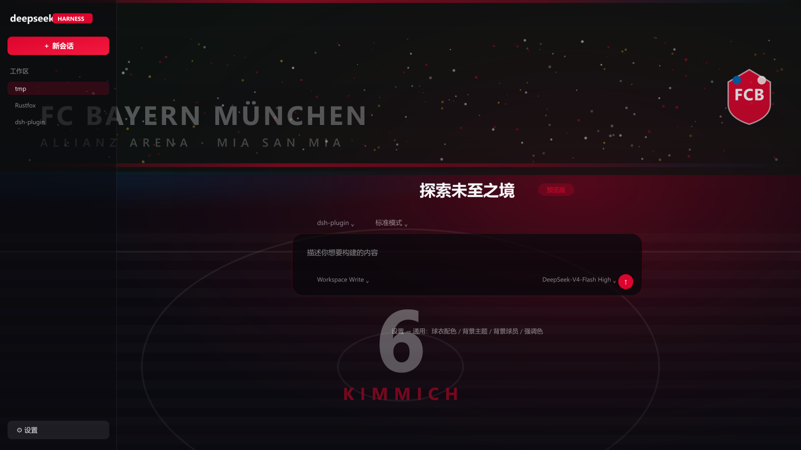

# dsh-client-ui-skin-bayern

[](https://awesome-dsh-plugin.com)

拜仁慕尼黑（FC Bayern München）主题的 DSH Web 界面皮肤 —— 主场红 / 客场白双配色，
真实赛场球员照片背景，外加四种程序绘制的插画背景。全部通过 dsh 的
`--dsw-*` 设计 token 重映射，与 `@pakiknowledge/dsh-client-ui-skin-claude` 同构
（一个 `dsh.client.platform = web` 的浏览器端 bundle）。




## 特性

- **球衣配色（主场红 ⇄ 客场白）**：一键切换整个画布
  - 主场红：深红黑画布（跟随系统明暗，亮色时是暖红纸面）
  - 客场白：纸白画布，不随系统明暗变化
- **背景主题** 五档：`photo` 真实赛场照片 / `jersey` 球员球衣 / `squad` 阵容号码墙 /
  `stadium` 安联球场 / `plain` 纯色
- **19 名一线队球员**：诺伊尔 1、乌帕梅卡诺 2、金玟哉 3、塔 4、基米希 6、格纳布里 7、
  格雷茨卡 8、凯恩 9、萨内 10、科曼 11、迪亚斯 14、奥利塞 17、戴维斯 19、布朗 21、
  穆勒 25、莱默 27、赛巴里 34、穆夏拉 42、帕夫洛维奇 45
- **4 种强调色**：拜仁红 #DC052D / 深红 #8B0F22 / 拜仁蓝 #0066B2 / 冠军金 #C9A227
- **自定义背景图**：设置行里粘图片 URL 即可替换
- 亮 / 暗双主题跟随系统；侧栏毛玻璃、俱乐部色顶部细线、俱乐部色滚动条与选中色
- 照片缺失时优雅回退：某个球员没有照片，`photo` 主题会自动改用该球员的球衣插画




## 安装

```sh
# 从 GitHub 安装（推荐）
dsh plugin --profile web add github:dirtywork22/dsh-client-ui-skin-bayern

# 或发布到 npm 之后
dsh plugin --profile web add dsh-client-ui-skin-bayern
```

`dsh plugin add` 会自动把这个包登记进 profile 的 `dsh.profile.bundles`，
**不需要手改任何配置文件**；刷新页面即可看到皮肤。

想关掉皮肤时把它从 `bundles` 里去掉，或给对应的加载项加 `disabled: true`。

皮肤互斥：同一时刻只启用一个皮肤，启用本皮肤时给其它皮肤行加 `disabled: true`。

## 背景照片说明

仓库自带 19 名一线队球员的赛场照片：它们已经内联进 `lib/client.js`（安装即生效），
原图与来源记录保留在 `photos/` 和 `photos/credits.json` 里，方便替换或重新裁切。

照片取自公开图片索引与公开报道，**版权归原媒体与摄影师所有**；本项目仅作个人、
非商业的主题化使用，不代表任何官方授权或背书。若权利人希望移除某张图片，
开个 issue 即可，会立刻删除对应文件并更新发布包。

换成你自己的图：

```sh
# 1) 把图片放到 photos/<球衣号码>.jpg（已是 16:9 的话可直接用）
#    竖构图 / 海报可以用 --frame blur 完整保留原图内容
node tools/from-image.mjs 我的图.jpg 42 --frame blur --keep-source

# 2) 重新内联进 bundle
node tools/embed-photos.mjs
```

也可以完全不用照片：把「背景主题」切到球员球衣 / 阵容号码墙 / 安联球场 / 纯色即可。
某个球员没有照片时，照片主题会自动回退成他的球衣插画。

## 设置（设置 → 通用）

1. **球衣配色** — 主场红 / 客场白
2. **背景主题** — 真实赛场照片 / 球员球衣 / 阵容号码墙 / 安联球场 / 纯色
3. **背景球员** — 19 名一线队球员
4. **强调色** — 拜仁红 / 深红 / 拜仁蓝 / 冠军金
5. **自定义背景图** — 粘 URL 应用，留空恢复

选择即时生效并保存在浏览器 localStorage。

> 这 5 行由**一次** slot 注册渲染，且只用原生 React 元素（`<select>` / `<input>`）。
> 设置面板会静默丢弃渲染时报错的行，改动设置行后跑一次 `node tools/verify-settings.mjs`
> 就能在真 React 渲染里发现问题。

## 工具

| 用途 | 命令 |
|---|---|
| 抓取球员照片 | `node tools/fetch-photos.mjs`（`--only 9 42` 指定号码，`FORCE=1` 覆盖） |
| 嵌入照片 | `node tools/embed-photos.mjs` |
| 生成预览图 | `node tools/preview.mjs`（`--art` 出插画版） |
| 设置面板自检 | `node tools/verify-settings.mjs` |
| 人脸留白自检 | `python tools/facecheck.py 0.12`（OpenCV 检出脸部并量化头顶空间） |
| 补顶部保护带 | `python tools/headroom.py 0.15 [号码...]`（头顶太贴边时自动下压） |
| 裁剪参考线 | `node tools/safearea.mjs 0.12`（标出页面会裁掉的区域，目视复核） |
| 重裁全部照片 | `node tools/reframe.mjs` |
| 用自己的图 | `node tools/from-image.mjs <图片> <号码> --frame blur\|plain\|cover` |
| 发布到 GitHub | `pwsh -File tools/publish-github.ps1 -Token <PAT> -Owner <用户>` |

隔离冒烟测试（另起实例在 3099 端口验证插件在真实启动流程里不报错）：

```sh
dsh web --patch tools/smoke-overlay.yml --port 3099 --no-open
```

## 许可

MIT（见 [LICENSE](LICENSE)）。插画背景全部是代码绘制的几何图形与文字，队徽为占位图形，
不含任何俱乐部官方素材；球员姓名与号码仅用于个人非商业的主题化描述，相关商标归其权利人所有。
背景照片的版权归原媒体与摄影师所有，详见上文「背景照片说明」。
